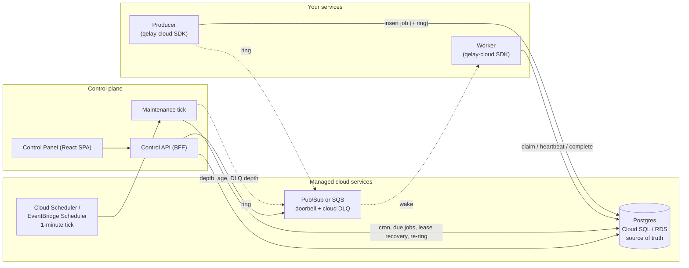

# Qelay-Cloud: design

Status: Phase 0 (spikes) is complete and the gate said go on 2026-10-13
([docs/spikes/06-phase0-gate.md](docs/spikes/06-phase0-gate.md)). Phase 1 (core on GCP) is complete **locally** as of
2026-10-14 (task 22): the whole core runs end to end on the in-memory, Postgres and Pub/Sub-emulator stacks, and the model
run, the 36 scenarios and the load check are green. **Nothing has run on a real cloud** (D9): the GCP run of the Phase 1
exit criterion, `terraform apply` and every "Needs D9" item are open. The gate's findings, the numbers and what remains
are in [docs/limits.md](docs/limits.md) and in the task 22 section of the gate document. Phase 2 (control plane) is
complete **locally** as of 2026-10-15 (task 37): a scripted operator walkthrough and the failure drills pass through the
real panel, every documented Control API operation passed an author-run security pass
([docs/security/phase2-pass.md](docs/security/phase2-pass.md)), and every read met its 500 ms target on 149,000 jobs
(limits section 10). Nothing of it has run on GCP, no image was built, and your sign-off on both gates is still owed;
work has continued under the standing instruction to go through every task.
Nothing here is production code yet. Everything marked "emulator" or "documented" was not run against a real cloud (D9).

Qelay-Cloud runs a Qelay-shaped job queue on managed cloud services (GCP first, then AWS)
instead of on a Qelay server process that we host and maintain. It has two deliverables:

1. **`qelay-cloud` SDK**: a `Queue` / `Worker` / `FlowProducer` facade that mirrors the Qelay
   (BullMQ-style) API, backed by Postgres plus the cloud's native queue.
2. **Qelay-Cloud Control Panel**: a clone of `qelay-control-panel` (`../qelay-control-panel`) that talks to a
   small Control API instead of a Qelay server and a local control agent.

Sources studied: `qelay` (`../qelay`, about 97k lines of TypeScript, MIT) and
`qelay-control-panel` (`../qelay-control-panel`, about 51k lines, React 19 + Bun).

## 1. Decisions

| # | Decision | Status |
|---|---|---|
| D1 | SDK plus provider-based panel. No queue server of our own. | Decided |
| D2 | GCP first, AWS second, behind one transport interface. | Decided |
| D3 | **Postgres is the job-state store** (Cloud SQL on GCP, RDS or Aurora on AWS). Same schema and code on both clouds. | Decided |
| D4 | Must-have features: core queue + DLQ, delayed jobs + cron, job inspector, flows / workflows. | Decided |
| D5 | **Postgres is authoritative; the cloud queue is a "doorbell"** (section 3). The engine is ported from Qelay, not rewritten. | **Decided** at the Phase 0 gate |
| D6 | Flows run on Postgres dependency tables, not Step Functions or Cloud Workflows. | Proposed |
| D7 | Panel is copied and diverges (it is pinned to Qelay 2.9.11 contracts), not consumed as a dependency. | Proposed |
| D10 | **Scale out by namespace, with an explicit map** (`QCLOUD_SHARDS`), one Postgres per shard. A namespace never spans databases. No hashing, no cross-shard queries. | Decided (review R21) |
| D11 | **A webhook is an event-gateway route** (section 6): a source, rules and a destination, an HTTPS URL or a queue. No route, no effect. No user code. (Its source was one queue's job events; D14 replaces that with an inbound source.) | **Decided** (owner, 2026-10-21); source superseded by D14 |
| D12 | **Inbound HTTP sources** for the event gateway: a public ingest URL per source that stores the request, then fans it out as events to routes (section 6). A separate ingest service, never the Control API or the tick. Needs its own security review, rate limits and `infra/`. | **Decided** (owner, 2026-10-23: approved as written) |
| D13 | **The gateway console gets a name, rules you can edit, delay and dedupe, issue state, reusable destinations and grouped counts** (section 6). All declarative, no user code, no new source. | **Decided** (owner, 2026-10-21: "implement the new features and ui changes, no need to ask"); its job-event wording is superseded by D14 |
| D14 | **The gateway carries what it is sent.** Its only source is an inbound request; the job events (`job.pushed`, `job.started`, `job.completed`, `job.failed`, `job.progress`), the delivery writer and the route loop check are removed. With no `shape` the destination gets the request body unchanged (section 6). | **Decided** (owner, 2026-10-23: "the event gateway should just process what has been sent to it and send it to the destination") |
| D15 | **A route can send at a set time and in batches** (section 6): a `schedule` (cron and time zone) holds a route's events until the next fire, and a `batch` sends many events in one signed request. Both are data on the route. | **Decided** (owner, 2026-10-23) |
| D16 | **DLQ retry is reopened.** One failed job, or a bounded set, goes back on the queue, guarded by its `version`; DLQ retention is settable through the API. No auto-retry. Reverses the Phase 0 closure of task 14 (k). | **Decided** (owner, 2026-10-23) |
| D17 | **A queue carries its own retry policy and run window** (section 6): default attempts, backoff and timeout for jobs that set none, and hours inside which workers may claim. | **Decided** (owner, 2026-10-23) |

The numbering above is this document's. The build plan's `CURRENT.md` has its own list (D1-D12) of decisions
that are the user's call, and its D1 (worker hosting) and D2 (doorbell granularity) are section 10's open
questions 1 and 2.

**What the Phase 0 spikes changed.** Details and evidence are in
[docs/spikes/06-phase0-gate.md](docs/spikes/06-phase0-gate.md).

| Change | Section |
|---|---|
| D5 is decided. | 1 |
| Invariant 2 names the lease token and an unexpired lease as the fence; `version` guards writers without a lease. | 3 |
| Invariant 3 is a stated bound, not "one sweep interval". Only the tick recovers a crashed worker's job. | 3 |
| The tick has a contract: re-ring age threshold, per-queue cap, grace period, delay window, and an opt-in in-process tick. | 3 |
| The Cloud Tasks relay is not a v1.0.0 component. | 3, 4, 5, 9 |
| `DeliveryTransport` and `StateStore` are settled, with six changes to the transport and one transport per queue. | 5 |
| The Cloud SQL connector is a tunnel, not a pooler. The connection budget and pooler rules are specified. | 7 |
| The doorbell DLQ is a metric. Rate limits, retry backoff and lease recovery run at tick speed unless the in-process tick runs. | 3, 10 |

Non-goals: embedded / in-memory mode, the Qelay TCP protocol and its multi-language SDKs, SQLite,
S3 SQLite backups, start/stop/restart of a server process, sandboxed workers (initially).

## 2. Why Postgres must be authoritative

SQS and Pub/Sub cannot do what the panel's job actions need once a message is in flight:

| Panel action | SQS / Pub/Sub |
|---|---|
| Promote a delayed job | Cannot find or alter a queued message by job ID |
| Change priority / delay | Messages are immutable |
| Cancel / discard | Cannot delete a message without its receipt handle |
| Look up by ID, list by state, per-state counts | No query API |
| Flow parent waits for children | No concept |

So job state lives in Postgres and every control-plane action is a transaction on a row. This
also means the inspector, counts and DLQ views are consistent reads, not eventually-consistent
projections.

## 3. Architecture



**Doorbell model.** A queue message carries no job state, only `{ namespace, queue, jobId }`.

- **Enqueue**: insert the job row in Postgres, then ring (publish a doorbell). Ringing is
  at-least-once and repairable. A crash between commit and publish delays a job by at most
  `reRingAfterMs` plus one tick interval; it never loses it. The store returns the doorbells to
  ring and the caller rings them, so a failed publish never fails an enqueue.
- **Work**: a worker receives a doorbell, then runs Qelay's claim query for that queue
  (`SELECT ... FOR UPDATE OF job SKIP LOCKED`, ordered by priority, FIFO/LIFO and group rules)
  and takes a lease (`lease_token`, `lease_until`, `version`). It does not have to receive the
  specific job the doorbell named: bells are fungible, and the claim takes the next job in queue
  order. Priorities, groups, rate limits and concurrency limits therefore stay in SQL where Qelay
  already implements them. The worker acks the doorbell after the claim attempt, never after the
  job, so the message's lifetime does not depend on how long the job runs. A claim never waits for
  a row another transaction holds, and right after a ring that row is the one recording the bell,
  so an empty claim is made once more after 25 ms while the queue still has a job waiting.
- **Duplicate or stale doorbells are harmless**: the claim finds nothing claimable and the
  worker acks the message.
- **Complete / fail**: one transaction updates the row, writes DLQ state and `qcloud_events`, and
  promotes flow parents whose dependencies are now satisfied. A retry clears `rung_at` and is rung
  again when it is due.

Invariants (each should become a test):

1. Postgres is the only source of truth for job state. Messages carry none.
2. A job is completed or failed only by the holder of its current lease. A lease holder's write is
   applied only if its `lease_token` matches and `lease_until` has not passed, under a row lock.
   `version` compare-and-set guards writers that hold no lease, such as operator actions.
3. No claimable job stays unrung for longer than `reRingAfterMs` plus one tick interval, whatever
   happens to publishes or doorbells. A crashed worker's job is claimable again within its lease
   plus one tick interval, and rung within one more, because recovery leaves it `delayed` by its
   backoff.
4. The cloud DLQ holds poison doorbells only, and is a metric: alert on it, never replay it, because
   the tick re-rings every claimable job anyway. A failed job goes to the Qelay DLQ
   (`state = failed` plus `dlq_entry`), which the panel shows.
5. Retries are bounded by `max_attempts`. An attempt is counted when it ends without success: on a
   failure and on lease recovery. A claim does not count one.

### Why bother with a cloud queue at all?

Postgres alone could serve the whole thing with polling. The cloud queue earns its place by
giving us: (a) wake-ups without polling, (b) native autoscaling triggers (Cloud Run on Pub/Sub,
Lambda/ECS on SQS), (c) managed redelivery and poison handling, and (d) native depth/age metrics
and alarms. Phase 1 therefore ships a `local` transport (Postgres polling plus `LISTEN/NOTIFY`) so
the system works and is testable with no cloud account, and cloud transports plug in beside it.

### Delayed jobs and cron

- The row's `run_at` is authoritative. A job with `run_at` in the future sits in state `delayed`.
- Transports declare `maxDeliverDelayMs`: SQS 900 s (`DelaySeconds`), Pub/Sub 0 (no
  per-message delay), local unbounded. The delay is relative to the transport's clock and rounded
  up, never down. If the delay fits, the bell is rung with `deliverAfterMs`. Otherwise the
  **maintenance tick** rings the job when it falls inside the transport's window.
- **Delay precision by hosting.** Cloud Scheduler's tick is one minute: a delayed job, a retry
  backoff, a rate-limited queue's next window and lease recovery all wait for it on Pub/Sub, so the
  mean lateness is about 30 s and the maximum about 60 s, and never early. Always-on workers can
  run the tick in process (below) and, on a transport that cannot delay (Pub/Sub), get a lateness
  of about half the interval (measured: a mean of about 0.55 of the interval, a maximum of about the interval). On one that
  can (SQS, local) the tick rings ahead and the lateness is the broker's, about 6 ms plus it. A
  Cloud Tasks relay (a task fires and publishes the doorbell) would give seconds precision to
  scale-to-zero handlers. It is documented, not prototyped, and **not a v1.0.0 component**.
- **Cron** reuses `qcloud_crons` and its due-scan (`FOR UPDATE SKIP LOCKED`). The tick creates the
  job and advances `next_run` in one transaction. Cloud Scheduler and EventBridge Scheduler both have a
  1-minute floor, so cron and interval schedules finer than a minute are caught up per tick.
  Documented limitation, unless the in-process tick runs.

### The tick

One idempotent function that is safe to run concurrently with itself. It does lease recovery
(stalled jobs), cron, promotion of due delayed jobs, TTL expiry, retention cleanup, and the re-ring.

- **Re-ring.** The tick rings every claimable job in an unpaused queue whose last doorbell is at
  least `reRingAfterMs` old, and `reRingAfterMs` is never greater than the tick interval. The age
  threshold, not a null check, bounds invariant 3, because bells are fungible and `rung_at`
  counts bells. `rung_at` means "a doorbell is deliverable at this time" (now, or `run_at` for a
  delayed bell), is set only for bells the broker took, and is cleared whenever a job returns to
  claimable (retry, recovery, resume, promotion).
- **Covered jobs (opt-in `ringCoverMs`).** An enqueue whose queue already has a claimable job rung in the last
  `ringCoverMs` ms rings nothing and records the new job as rung at that bell's time. One bell wakes a worker, and a
  worker whose claim came back full keeps claiming as its slots free (`claimAgain`), so it drains the backlog without
  more bells. What that leaves behind (a worker that found the queue empty a moment before the add, or a consumer
  that does not claim again) is found by the same re-ring, at most `reRingAfterMs` after the covering bell. A covered
  job takes its bell's age, never now, so a steady stream of adds cannot hold the window open. The model harness does
  not cover it (it breaks "deliverable bells >= claimable jobs" by design); the store tests and
  `worker.pump.test.ts` do.
- **The tick's re-rings have their own cap.** `maxStaleRingsPerQueue` (default: the per-queue cap) limits the jobs
  whose bell has aged out, so a deep healthy backlog is not rung in full each interval, while jobs never rung keep
  the whole cap.
- **Limits on the re-ring.** A cap per queue per tick: under a backlog, an uncapped tick rings one
  doorbell per waiting job every time. A grace period for a job with no `rung_at` yet, so the tick
  does not ring jobs whose publish is still in flight.
- **Recovery is the tick's alone.** A later doorbell claims nothing while a dead worker's row is
  `active`, so a crashed worker's job waits for the tick: the lease, then one tick to recover it,
  then (it is `delayed` by its backoff) one more to ring it.
- **Delay window.** The tick pre-rings jobs whose `run_at` is inside the transport's window,
  clamped to `maxDeliverDelayMs` and at least one tick interval plus the worst tick lateness.
- **In-process tick (opt-in).** An always-on worker may run the tick itself every few seconds
  (default 5 s). The leader is chosen by a **lease row** read against the database clock, with a
  length of about three intervals. It is not a session advisory lock: behind a transaction pooler
  a session lock admits two holders. The lease is an efficiency device, and the tick stays safe
  when two run. A crashed leader is replaced within about the lease length; a graceful one hands
  over within a tick. In a worker's shutdown the loop stops after the jobs are released and before
  the transport closes, because its last beat may still ring. It is also run as an endpoint
  (`POST /internal/tick`, OIDC or a shared secret) and a CLI (`qcloud-tick run | serve | loop`).
  `loop` is the always-on form: a beat every second by default, with the retention steps (they
  free space and gain nothing from running each second) on their own 30 s schedule per process
  (`upkeepEveryMs`; recovery, crons, promotion, expiry and the ring query run on every beat).
  Both Terraform examples run it as `tick_loop`: a fixed count of tasks of the tick image on the tick's identity, next to
  the scheduler. `webhook_sender` does the same for `qcloud-tick send`, with the webhook key (`webhooks`) readable by the
  tick and the control plane and by no worker. Both hold database pools the budget counts, under the workers' database user.
- **Cloud Scheduler stays.** The 1-minute scheduler tick is the safety net and the cron source,
  and the in-process tick never replaces it.

### Shards (review R21)

Every table is scoped by `namespace`, the journal lock and the tick lease are per namespace, and a transport's topics and
queues are per namespace, so a namespace is already a unit that needs nothing outside itself. Scaling out is therefore
a routing table, not a data-model change: `QCLOUD_SHARDS=acme=a,globex=b` says which database holds a namespace, and
`QCLOUD_SHARD_A_DATABASE_URL` (with any `QCLOUD_SHARD_A_DATABASE_*` override of the shared `QCLOUD_DATABASE_*`) says how to
reach it. `ShardMap` (`packages/store-postgres`) is that table; the SDK (`shards` option), the Control API and `qcloud-tick`
each look their namespace up and open that one database.

- **Explicit, not hashed.** A hash moves namespaces when a shard is added; here one moves only when someone edits the
  map and copies its rows. A namespace the map does not list is refused, not guessed.
- **One TickLoop per namespace, one pool per shard.** `QCLOUD_SHARD=a qcloud-tick loop` ticks every namespace of shard
  `a` over one pool. The lease key is the namespace, so two such processes still fail over.
- **The Control API and the panel stay one namespace per process.** The map chooses that process's database. A request-time
  router needs the namespace in the URL and the authorization model and is not built.
- **A single namespace cannot be split.** The gain comes from several namespaces, not from one busy one.
- **Not built:** moving a namespace (manual), views across shards, Terraform for several databases, the connection
  budget as one number (it is per shard). Not measured under load.

## 4. Feature mapping

| Qelay feature | Lives in | GCP | AWS | Reuse from Qelay |
|---|---|---|---|---|
| Add / bulk add / dedup / custom ID | Postgres | - | - | `deduplication.ts`, `admission*.ts` |
| Delivery + wake-up | Transport | Pub/Sub (pull or push) | SQS standard queue | new |
| Claim, lease, heartbeat, stall recovery | Postgres | - | - | `claimSelection.ts`, `leaseStore.ts`, `recovery.ts` |
| Retry + backoff | Postgres + re-ring | - | - | `completion*.ts` |
| DLQ (job failures) | Postgres | - | - | `dlqLifecycle.ts` |
| DLQ (poison doorbells) | Transport | Dead-letter topic | Redrive policy | new |
| Delayed jobs | Postgres + tick | tick (1 min; seconds with the in-process tick) | SQS `DelaySeconds` up to 900 s, then tick | `promotion.ts` |
| Cron / interval | Postgres + tick | Cloud Scheduler | EventBridge Scheduler | `crons.ts`, `cronParser.ts` |
| Priority, LIFO, groups | Postgres | - | - | `claimSelection.ts`, `groups.ts` |
| Rate limit, concurrency | Postgres | - | - | `rateLimit.ts`, `qelay_queue_state` |
| Job inspector, counts, logs | Postgres | - | - | `queries.ts`, `logs.ts`, `readModels.ts` |
| Flows (parent/child DAG) | Postgres | - | - | `qelay_dependencies`, `dependencyPromotion.ts`, `flowFailures.ts` |
| Workflow Engine (durable steps, signals, sagas) | Postgres (new store) | - | - | `src/client/workflow/*` (section 8) |
| Events / live activity | Postgres `qcloud_events` | - | - | `events.ts`, `eventJournal.ts` |
| Workers page | Postgres heartbeats | - | - | `workers.ts` |
| Metrics | Postgres buckets + cloud metrics | Cloud Monitoring | CloudWatch | `qelay_metric_*` |
| Webhooks | Postgres config + deliveries, sent by the tick | - | - | `qcloud_webhooks`, `qcloud_deliveries` (before migration 13 `qcloud_webhook_deliveries`), `webhookSender.ts` (task 52; upstream `webhookManager.ts` was in-memory) |
| Process start/stop/restart, SQLite inspector, S3 backup, Fleet | n/a | dropped | dropped | n/a (replaced by managed backups and deploy status) |

## 5. Packages

```
Qelay-Cloud/
  DESIGN.md
  packages/
    core/             types, job state machine, StateStore + DeliveryTransport interfaces
    store-postgres/   StateStore over Postgres (ported from qelay's postgres/ modules)
    transport-local/  Postgres polling + LISTEN/NOTIFY (dev, tests, no-cloud installs)
    transport-gcp/    Pub/Sub
    transport-aws/    SQS (+ DelaySeconds)
    sdk/              Queue, Worker, FlowProducer, QueueEvents facade
    maintenance/      the tick: cron, due-job ringing, lease recovery, retention
    control-api/      Qelay-shaped HTTP for the panel; /internal/tick; /capabilities
    panel/            clone of qelay-control-panel
  infra/
    gcp/              Terraform: Cloud SQL, Pub/Sub topic + subscription + DLQ, Cloud Run, Scheduler, IAM
    aws/              Terraform: RDS/Aurora, SQS + DLQ, ECS/Lambda, EventBridge Scheduler, IAM
```

Runtime and tooling follow the existing projects: Bun, strict TypeScript, Oxlint/Oxfmt.

### Interfaces (settled at the Phase 0 gate; task 10 writes them down)

```ts
interface Bell { namespace: string; queue: string; jobId?: string }   // jobId is a hint, never a claim
interface RingItem { bell: Bell; deliverAfterMs?: number }             // relative, rounded up

type RingResult =
  | { ok: true }
  | { ok: false; reason: 'delay-too-long' | 'rejected' | 'unreachable' };

interface Delivery {
  readonly bell: Bell | null;          // null: the body is not a bell
  readonly attempt: number | null;     // the broker's delivery count, if it keeps one
  ack(): Promise<void>;                // after the claim attempt, never after the job
  nack(retryInMs?: number): Promise<void>;
}

interface DeliveryTransport {
  readonly capabilities: {
    maxDeliverDelayMs: number;         // SQS 900_000, Pub/Sub 0, local unbounded
    maxRingBatch: number;              // SQS 10, Pub/Sub 1_000
    attemptCount: 'approximate' | 'none';
    retryGranularityMs: number;        // SQS 1_000
  };
  ring(items: readonly RingItem[]): Promise<RingResult[]>;          // one result per item, in order
  subscribe(queue: string, handler: (d: Delivery) => Promise<void>,
            opts: { capacity: () => number }): { refresh(): void; close(): Promise<void> };
  stats(queue: string): Promise<{
    depth: number | null; inFlight: number | null; delayed: number | null;
    oldestAgeMs: number | null; deadLetterDepth: number | null;
    source: string; observedAt: number; maxStalenessMs: number;   // dashboards show the staleness
  }>;
  close(): Promise<void>;
}

interface StateStore {                                  // time comes from an injected Clock (default: database)
  enqueue(jobs: NewJob[]): Promise<EnqueuedJob[]>;      // carries the rings; the caller rings, then markRung
  markRung(rung: { jobId: string; deliverAfterMs: number }[]): Promise<void>;  // only where still pending (waiting, prioritized, delayed)
  claim(queue: string, owner: string, n: number): Promise<ClaimedJob[]>;   // does not count an attempt
  heartbeat(lease: Lease): Promise<boolean>;
  complete(lease: Lease, result: unknown): Promise<Outcome>;   // promotes flow parents; returns rings
  fail(lease: Lease, error: FailureInfo): Promise<Outcome>;    // retry or DLQ; counts the attempt
  tick(budget: TickBudget): Promise<TickReport>;               // recovery, cron, due, re-ring; moreWork flag
  // reads and operator actions used by the Control API:
  getJob(id: string): Promise<JobRecord | null>;
  listJobs(q: JobQuery): Promise<Page<JobRecord>>;
  counts(queue: string): Promise<StateCounts>;
  // ... pause/resume, promote, change priority/delay, DLQ ops, crons, workers, events
}
```

**Transport.** One cloud queue per Qelay queue: `subscribe` and `stats` take the queue, and `ring`
routes each bell by `bell.queue`. On GCP that is one topic per environment with a filtered
subscription per queue, or, for a *hot* queue, a topic of its own (`qcloud.<ns>.hot.<queue>`) with an unfiltered
subscription, so a busy queue's bells are not delivered once per queue of the environment. The list is configuration
(`QCLOUD_GCP_HOT_QUEUES`), kept in one place (`names.ts`). A worker that receives a bell for a queue it does not serve can do nothing
with it, and SQS cannot filter. Adding a queue is an infrastructure change.

**Store.** Every mutation that makes a job claimable returns the doorbells to ring, with the delay
measured on the database clock at the call (`dueInMs`), so no absolute time crosses the boundary.
Every write is guarded by lease token or version, so a caller that hits the operation deadline can
treat the outcome as unknown and retry or drop it without a double effect. Randomness (backoff
jitter) and job ids (UUIDv7, so LIFO order is checkable) are injectable.

`StateStore` has one implementation (Postgres). The interface exists so the SDK, Control API and
tests do not import `pg` directly, not to support other databases.

## 6. Control API and panel changes

The panel's HTTP layer, `src/lib/bq/` (in `../qelay-control-panel`), is only about 1,600 lines and talks to a
fixed set of Qelay endpoints (`/dashboard`, `/queues/summary`, `/queues/:q/jobs/list`,
`/jobs/:id/*`, `/crons`, `/workers`, `/events` SSE, `/stats`, `/health`, ...). The cheapest correct
adaptation is for the **Control API to serve those same shapes from `StateStore`**, so most pages
keep working unchanged. The panel then gains:

- A `GET /capabilities` call that hides pages that do not apply (Server Control, SQLite
  Database, S3 Backup, Fleet).
- A **Transport** page: queue depth, oldest message age and cloud DLQ depth, from `transport.stats()`.
- A **Deployment** status panel (provider, region, DB target, last tick) replacing
  `/control/status`.
- Flow, Queue-operations and Workflow routes served by the Control API in-process. Today these go
  through the local agent because the Qelay client is TCP-only; here the SDK talks to Postgres.

Several panel actions are deliberately disabled today (DLQ retry, completed-job requeue, drain,
clean, obliterate) because Qelay's HTTP contract has no atomic generation precondition. With
single-transaction operations guarded by `version`, the Control API could make some of them safe.
Parity first: keep them closed in v1 and revisit afterwards.

Auth for the Control API is OIDC JWT verification (D4, section 10): the issuer, audience and JWKS URL are configuration, so
IAP / OIDC on GCP and Cognito / OIDC on AWS are the same code with different values.

**As built (task 30, `packages/control-api`).** The core is in: a `Bun.serve` server over a small router, the error
model `{ error: { code, message, details? } }` (the panel's own clients read `{ error: string }`, which task 34
adapts), OIDC and a development token that refuses production, roles `viewer` and `operator`, an exact-origin CORS
list, a per-instance token-bucket limit on writes, `/health` (the only route without a token), `/health/ready`
(also `/ready`, the path the panel probes), `/capabilities`, and `/dashboard` and `/stats` answering 501 until task 31
wires the reads. [packages/control-api/README.md](packages/control-api/README.md) describes the pipeline and the
configuration; [docs/openapi.yaml](docs/openapi.yaml) documents what is served, and a test keeps the two equal.

**As built (task 31).** The panel's Dashboard, Queue Control, Add Job and Job Inspector paths are served from `PostgresStore`
with the shapes the panel parses (a contract test runs the panel's own validators on them). What the design asked for,
and what was decided where it left room:

- **Destructive actions** (`drain`, `clean`, `obliterate`) take `{ confirm: <queue name> }` and the `operator` role, and
  are bounded: each stops at a time budget and answers `done: false` so the caller asks again. A job action takes an
  optional `expectedVersion`; a stale one is 409 and nothing changes. Optional because the panel does not send one
  today (task 34 adapts it).
- **Closed in v1, as "Parity first" says** (DLQ retry was reopened by D16, 2026-10-23): retrying a failed job (DLQ retry, task 14 (k)), `fail`, `discard`,
  `move-to-wait`, `move-to-delayed`, and changing `lifo`. They answer 501 `not_supported` with the capability name.
- **Payloads** carry the tagged encoding (`bigint`, `date`, `bytes`, `map`, `set`, `-0`, `undefined`) and a
  `truncated` marker over a byte budget; a decoded payload round-trips through add and edit.
- **Bounds:** every list is paged (500), `offset` stops at 100,000 and a keyset cursor goes on, `/dashboard/queues` stops at
  offset 10,000, and a 100,000-job queue's counts, summary, dashboard and queue page read in tens of milliseconds
  (index-only aggregates) and cache for 2 s per instance.
- **Deviations the panel will see:** `waiting` excludes `prioritized` (the panel's summary has both); `paused`
  counts waiting and prioritized jobs while the queue is paused; throughput rates are deltas of the journal between two
  reads; latency is empty; a job's `timeline` is capped at 20 entries (the panel's own limit); `version` restarts at 0
  when a finished job's custom id is replaced; `lastHeartbeat` is not sent.
- **Not served here:** the worker protocol routes (`/jobs/heartbeat-batch`, `/jobs/ack-batch`,
  `/queues/:q/jobs/pull-batch`): workers use the SDK, not HTTP. A single-job read carries `parentId`, `childrenIds` and
  `flowRoot` (task 51); a listing carries `parentId` and `flowRoot` only, and `dependsOn` is always empty.

**As built (task 32).** The DLQ, Cron, Workers, Diagnostics and Activity paths are served from `PostgresStore` with the shapes
the panel parses (a contract test runs the panel's own validators and frame parser on them), and every operator change is
audited. What the design asked for, and what was decided where it left room:

- **Audit log.** `qcloud_audit` (migration v5) is written in two phases: a row is opened before the handler runs, so a
  change that cannot be recorded is not made (503 `audit_unavailable`), and closed with the outcome (`success`,
  `rejected` with the error code, `failed`). A caller the role check or the rate limit refuses is recorded too. A row is
  who, what (the route template), which (path parameters and the name of what a body creates), the request id, the status
  and the times: never a payload, a query string or a credential. It is append-only and kept 90 days or 100,000 rows,
  pruned by appends. Unauthenticated calls and unknown routes are not recorded: nothing was identified or changed.
  `GET /audit` is operator-only and pages by entry id.
- **Events.** `GET /events` is a poll of the journal (`pollMs`, 1 s), not a push: the transport has no wake-up for a
  journal commit, and a shared in-process hub would not cross instances anyway. A frame's `id` is the journal position
  `<commitSeq>.<eventId>`, ordered by commit, so `Last-Event-ID` resumes without a gap or a repeat while writers commit
  concurrently (test: 40 concurrent writers make 120 events, a client hangs up after 15 and resumes). A client past the retention gets one `resync` frame. The
  server never reads ahead of a client: the stream is pull-driven over a byte-bounded queue, so a stalled socket holds one
  buffer and one page, and a client that leaves the buffer full for `slowClientMs` is dropped.
- **Load balancer numbers** (for tasks 36 and 43): heartbeat every 15 s, a stream closed at 10 min and resumed by the
  client, `Bun.serve` `idleTimeout` 255 s (its maximum), and the panel treats 45 s of silence as a dead link. Cloud Run's
  request timeout must be at least 10 minutes (its maximum is 60), and an ALB's idle timeout at least 30 s (its default is
  60 s); the 15 s heartbeat keeps both busy.
- **Closed in v1, as "Parity first" says** (DLQ retry and retention were reopened by D16, 2026-10-23; auto-retry stays closed): DLQ retry (task 14 (k)) and a change to DLQ retention or auto-retry through the
  API answer 501 naming the action (`dlq-retry`, `dlq-auto-retry`, `dlq-retention`; the SDK still sets `maxAge` and
  `maxEntries`). The stall settings other than `maxStalls` describe how a lease works and are 400 when a save changes
  them. The server-process pages (`/gc`, `/heapstats`, `/prometheus`) answer 501 `serverControl`.
- **DLQ purge** takes `{ confirm: <queue name> }` like drain, and is bounded by `actionBudgetMs`. The panel's call has no body
  and gets 400 until task 34 sends it.
- **Cron** is validated by the store's own parser, so what Qelay accepts is accepted and the rest is 400 naming the
  option. A re-save keeps `executions` and moves `nextRun` only when the timing changed. `lastRun` is not stored (the panel
  has no field for it); a nullable column would add it later.
- **Not served:** latency and wait-time percentiles (not recorded, not estimated), a worker's `currentJob` (always null),
  the panel's queue-operations metrics (they come from the local agent), and the job `name` in an event frame.

**As built (task 52, [docs/webhooks.md](docs/webhooks.md)).** Webhooks are persisted (migration 8: `qcloud_webhooks`,
`qcloud_webhook_deliveries`; partitioned by day in migration 13 as `qcloud_deliveries`) and sent by a step of the tick, after
the store's own work and the ringing. What was decided where the design left room:

- **A writer, not the trigger, can make the deliveries (migration 14, review F7).** *History: D14 removed both, with the job
  events they served (migration 21); deliveries are made by the accept of an inbound request.* The trigger cannot apply a per-webhook
  filter or shape, and a shaped body must be the same bytes on every retry. A row in `qcloud_webhook_writers` moves a
  namespace to a writer that reads the journal after a cursor, matches each event with the enabled webhooks (`filter`, `shape`,
  `active_from`), renders the body once into `qcloud_deliveries.body` and moves the cursor, in one transaction. The trigger
  keeps working for namespaces without a row, so the default is unchanged. Switching off is lossless: the trigger resumes
  first, the writer catches up, and a final `FOR UPDATE` on the row waits for job transactions that skipped their deliveries.
  The cost is that deliveries are written a moment after the job's commit, not in it, and an event the journal's retention
  removes first makes none. Filters and shapes see the seven fields of the event, not the job's `data`, because the journal
  carries none; adding job data would need it in the journal (a payload copy per event) and is not built.
- **Deliveries are partitioned by day (migration 13, review F2).** Finished rows were deleted one by one on the hot table,
  which kept a standing load of dead tuples. `qcloud_deliveries` is partitioned by `created_at` (the event's time), and the
  tick drops a day whole once it is `webhookKeepMs` (default 2 days, was 7) past its end and holds no live delivery. A default
  partition takes a row whose day has no partition, so a write never fails for a missing one. The `events` table is not
  partitioned: its retention is a cap per queue, not an age, and its readers need one ordered key. See docs/limits.md,
  "Webhook deliveries by day".

- **Deliveries are made in the job's transaction.** *History: D14 removed this trigger in migration 21.* A trigger on `qcloud_events` inserts one delivery per enabled webhook
  that matches the event, so a job and its deliveries commit together and a webhook sees only events committed after it
  was registered. Only pushed, pulled, completed, failed and progress have a webhook name (`job.pushed` ... `job.progress`).
  The trigger costs the job path about 1.1x on claim and complete and 1.6x on enqueue with nine delivery rows per job.
- **The store stays DB-only; the network is in `packages/maintenance`.** `store.webhooks.claimDue` takes deliveries (the
  webhook rows `FOR NO KEY UPDATE SKIP LOCKED`, round-robin across webhooks, at most a rate per webhook per minute) and
  `recordAttempts` writes the outcomes, fenced on the attempt number and `status = 'sending'`: four concurrent ticks never
  send one attempt twice, and an answer that arrives after its lease lapsed is dropped (so a send can repeat; it is
  at-least-once and the receiver deduplicates on `X-Webhook-Id`).
- **Signing:** `X-Webhook-Signature: v1=hex(HMAC-SHA256(secret, "<timestamp>.<body>"))`, a 300 s replay window. The secret is
  sealed (AES-256-GCM, authenticated with the row's identity) under `QCLOUD_WEBHOOK_KEY`, which the database never holds,
  and is never returned after the call that sets it, except that a secret the service generated (a store with a key, none
  given) is returned once in the create or rotate response. A store with a key signs every webhook; without one,
  webhooks are unsigned and listed as `signed: false`. Rotation keeps the old secret signing beside the new for 24 hours.
  A webhook whose deliveries fail 20 times in a row (every attempt used) is paused: `enabled = false` with a reason, deliveries
  still collected for 24 hours, enabling it clears the pause.
- **SSRF:** `https:` only outside development, no credentials, no private name, every resolved address public, the request
  sent to the address that was checked (not the name), no redirect followed, no response body kept (a failed answer's first 1 KB is kept as text on the attempt). Registration validates
  the string and does not resolve the name; the send-time check is the defence. An independent review is owed in task 72.
- **The body carries no job data**, only ids and the state after the event. Best-effort order, no ordering guarantee.
- **Routes:** `/webhooks` (list, create), `/webhooks/:id` (get, delete), `/webhooks/:id/enabled`, `/webhooks/:id/test`
  (a `webhook.test` event), `/webhooks/:id/deliveries` (history, paged by a keyset cursor, filtered by status) and
  `.../deliveries/:deliveryId/retry` (a failed delivery gets a fresh budget). Writes need `operator` and are audited by
  `webhook=<id>` only. A viewer reads a webhook's address cut to its origin (`urlRedacted`). `features.webhooks` follows the
  jobs routes being served.
- **One queue per webhook, not a list** (the task asked for a queue filter; the upstream panel had one queue field).
- **Volume:** the sender is operator-scale. Fan-out to third parties belongs in a separate SDK-run delivery queue, not the
  tick. A `queue` destination (D11 below) writes a job row in the same database, so it is operator-scale too.

**Event gateway (D11, decided 2026-10-21; built in the event-gateway plan, tasks 08 to 12).** *History: D14 (below) removed
this section's queue source, its loop check and the job events; read it for how the routes, kinds and destinations came to be.* Asked for on 2026-10-21 with Hookdeck as the reference. A webhook
is already a Hookdeck connection with one fixed source, so this changes the words and adds a destination kind; it renames
no table and no route.

- **Words.** A webhook is a **route**: a source (the events of one queue, from the journal), rules (`filter`, `shape`, rate,
  retry schedule, auto-pause) and a destination of a **kind**. A delivery is an **event** with **attempts**.
  `qcloud_webhooks`, `qcloud_deliveries` and `/webhooks` keep their names: the previous release reads and writes them.
- **Kinds.** `http` is today's URL and the default for every existing row. `queue` adds a job to a queue of the same
  namespace through the store's own enqueue, so pause, rate limit, queue limits and dedupe apply. The job's `data` is the
  body the route's `shape` renders and its `name` is the event's name. If the store refuses, that is a failed attempt and
  follows the route's retry schedule like a 5xx. Filters and shapes still see the seven fields of the event, not the
  job's `data`.
- **"Start a workflow" is a queue route.** The Control API and the tick hold no workflow definitions and run no engine
  (section 8): a run starts in a process that registered the workflow, by `start()`. So a route to a workflow is a `queue`
  route whose worker calls `startWorkflow(name, data)`. A built-in `wf:start` job that every engine understands would
  change the engine all workers run, and a worker that predates it would fail the job. Not decided here; say so if you want it.
- **No route, no effect.** An event with no enabled matching route does nothing, as now. "When A happens, do B" is a route
  from A's queue to B's queue, opted into per route. A chain is routes feeding routes: the job a route adds is a job like
  any other, and its events can match the next route.
- **Loops are refused when a route is saved, not found at run time.** The check reads the namespace's routes as edges from
  a source queue to a destination queue. It answers `409 route_cycle` when the new edge closes a cycle and
  `409 route_chain_too_long` when the longest chain would pass 5. A `queue` route needs a source queue (an all-queues
  source would match the events of its own destination's jobs). It runs on create, on a change of queue or destination and on
  enable, over every route whether enabled or not, under `pg_advisory_xact_lock` on the namespace (transaction-level only,
  pooler-safe), so two saves cannot make a cycle between them. There is no run-time depth counter: it would put a column on
  the job and the event, on the claim and complete paths, for a loop the save check already refuses. A job a worker's own
  code adds is not a hop.
- **Migration 16 is additive (task 08).** `destination text NOT NULL DEFAULT 'http'` checked against `http` and `queue`, and
  a nullable `target` (the queue). `url` stays `NOT NULL` and holds the empty string for a queue route. A sender that
  predates the migration cannot send to it and fails the delivery without a request; so the runbook says to add the first
  queue route after every tick runs the new release.
- **No user code and no new source in D11.** `filter` and `shape` stay declarative. Inbound HTTP sources are D12 below.
  Still out, and each its own decision: JavaScript transforms, delay, dedupe, replay of a request, Hookdeck's Issues as
  stored state (the panel shows a read-only view derived from paused and failing routes; Alerts and auto-pause stay).
- **What is added beside it:** bulk retry of failed events (one operator action over a status filter, bounded by the store's delivery page limit), and the panel's Event gateway
  page takes the place of the Webhooks page, with the same routes under it.

**Gateway features (D13, decided 2026-10-21; plan `.claude/.planning/gateway-features/`).** *History: D14 moved delay and
dedupe from the delivery writer to the accept transaction and made dedupe fields request paths.* The console Hookdeck-style work
(plan gateway-ui) stopped at five proposals, G1 to G5; the owner approved all of them. Each keeps D11's rule: declarative
data only, no code runs, and no route means no effect. Migrations 17 to 19 are all forward-only and safe with old workers:
nullable or defaulted columns and new tables.

- **A name and a description** for a route (`name`, `description`, both nullable), and **`PATCH /webhooks/{id}`** to change
  them and a route's **rules**: `events`, `filter`, `shape`, `delay`, `dedupe`. The source queue and the destination are not
  editable: a different one is a different route (remove and add), so the loop check stays where it is (create, enable).
  A change applies to events from then on; deliveries already made keep the body they were made with.
- **Delay and dedupe are rules of the writer**, like `filter` and `shape`: they need the delivery writer on, and a route with
  one blocks switching it off. The order an event goes through is filter, dedupe, shape, delay, then the sender's rate limit
  and retries. `delay` is `delayMs` (1 s to 1 h): the delivery is made as now and is not due until `delayMs` after the event.
  `dedupe` is `{ windowMs, fields }`: of the events a route accepts, the first with a given value of those `fields` (any of
  `event`, `queue`, `jobId`, `state`, `error`) goes, and later ones with the same values inside the window are dropped, not
  recorded. The window starts at the first event and a repeat does not extend it. Keys are kept as a hash in
  `qcloud_webhook_dedupe`, written in the writer's transaction (so a crashed pass repeats cleanly) and pruned by the tick.
- **The shape is the transform.** Hookdeck's JavaScript transform stays out: `shape` already rewrites the body
  declaratively, and now it can be edited. A user-code transform would be a new trust boundary and is a separate decision.
- **Pause holds, disable ignores.** `PUT /webhooks/{id}/enabled` takes an optional `mode`. `hold` (the panel's Pause) turns the
  route off but keeps making its deliveries, so Resume sends what was held; it is the pause an auto-pause makes, marked with
  the reason `paused by an operator`, which is not an issue. `ignore` (the panel's Disable, and the default, as before) turns it
  off and makes none. Resume from either needs no new column: the existing `disabled_reason` carries it.
- **Issues are stored state** (`qcloud_webhook_issues`): one live issue for each route that is failing or was paused for failing,
  opened by the sender's recording path and resolved by it when a delivery succeeds. An operator can acknowledge, ignore,
  resolve or reopen one (an audit row each). A resolved issue that fails again is a new issue. Ignoring only hides it from
  the open list and from Home: the route's state, alerts and auto-pause are unchanged.
- **Reusable destinations** (`qcloud_webhook_destinations`): a named `http` URL or `queue` target that connections choose.
  A connection keeps its own copy of the address (the sender and writer read only `qcloud_webhooks`), plus the id of the
  destination it came from; changing a destination rewrites the copy of every connection that uses it, in one transaction,
  re-running the loop check. A destination in use cannot be removed. A secret is never part of a destination: each connection
  has its own, as before. **A source stays a queue** (reusable sources arrive with D12's inbound sources, which are the
  only source with state of its own).
- **Grouped counts**: `GET /webhooks/stats?groupBy=webhook` answers the same window with one entry per route (outcome counts and
  a trend, no latency) in one read, for the list.

**Inbound sources (D12, decided 2026-10-23, approved as written; plan `.claude/.planning/inbound-sources/`).** Asked for on
2026-10-21 so the console can match Hookdeck: a third party (Stripe, Shopify, an internal service) posts to a Qelay URL and
the request becomes events.

- **Words.** A **source** has a public URL and a verification rule. A **request** is one stored inbound HTTP call. A route's
  source is one inbound source (D14 removed the other kind, one queue's job events). An event is a delivery of a request to
  a route, with attempts, as today.
- **A separate ingest service.** The Control API is operator-scale and authenticated; the tick is a scheduled job. A public
  endpoint at third-party volume is neither. The ingest is its own process (Cloud Run service on GCP, a container on AWS)
  that only validates, stores and answers. It never runs a route, never calls the destination and never reads job state.
  A request is stored in the same database (`qcloud_requests`) and the existing tick sender delivers the events, so the
  ingest holds no outbound network access.
- **Request path.** Method allow-list, size cap, content-type cap, per-source and global rate limit (a 429 before any
  write), verification (HMAC with a stored secret, basic auth, API key, or none, chosen per source, constant-time compare),
  store, then one event row per enabled route of the source, in one transaction, then the configured synchronous answer.
  A request that fails a check is stored as `rejected` with a cause (so it is visible), up to a cap per source per minute so
  an attacker cannot fill the table.
- **Event body.** The request's body, headers and query are what a route's `filter` and `shape` see. With no `shape` the
  destination gets the request body unchanged, with its content type; a `shape` rewrites it to JSON (D14).
- **Storage and retention.** Bodies are capped (256 KB) and pruned by the same maintenance retention as deliveries.
  Secrets are not stored in clear text and are never returned by the API (shown once, as the webhook secret is now).
- **No dependency.** The ingest is `Bun.serve` in `packages/ingest`; it imports the store and core only, never a transport
  or the sender (`bun run architecture` checks it). There is no Stripe preset: a generic HMAC covers it.
- **Not in D12.** JavaScript transforms, delivery groups, a CLI destination, replay of an arbitrary request to another source
  (replay to the same routes is in). Each is its own decision. Delay and dedupe, which D12 first left out, are D13's and stay
  (D14).
- **Gates it passes through:** a migration, new Control API routes and openapi, a new service under `packages/` and
  `infra/` (plan only; `terraform apply` needs the owner), a security review of the ingest path, a load check against
  the connection budget, and a real-cloud run that only the owner can authorise (D9). The first four were approved on
  2026-10-23; the real-cloud run was not and is not part of the build.

**The gateway carries what it is sent (D14, decided 2026-10-23).** The owner asked, after seeing "Events to send" on a
connection: should the event be what was sent to the gateway, transformed, and the processed event what reaches the
destination? A request `{ "id": 500, "name": "chris" }` with no transform arrives as `{ "id": 500, "name": "chris" }`. The five
fixed events only made sense while the thing entering the gateway was always a job event with seven fixed fields. They are
removed, and so is what existed only for them. Nothing in 1.0.0 was released, so this is one forward migration, not the
two-release removal CLAUDE.md asks of a shipped release.

- **Source.** The only source of a route is an inbound source. A request is one event for each of its source's routes that
  accepts it, made in the accept transaction. There is no journal cursor, no delivery writer to switch on and nothing for the
  tick to scan; the tick's sender delivers.
- **The event document.** What `filter`, `shape` and `dedupe` see is `{ method, headers, query, body }`, read by a dotted path
  (`body.id`, `headers.x-github-event`, `query.page`). `body` exists when the request was JSON. A non-JSON body is passed
  through whole and cannot be addressed. Paths are data: they walk own properties of plain objects and arrays, never
  `__proto__`, `constructor` or `prototype`.
- **Order** for a route: pause mode, `filter`, `dedupe`, `shape`, `delay`, then the sender's rate limit, retry schedule and
  auto-pause, unchanged. Pause holds and disable ignores, as in D13.
- **Dedupe is atomic.** Several ingest processes run at once, so the old single writer that made the cursor version exact no
  longer exists. One upsert per key (`INSERT ... ON CONFLICT DO UPDATE ... WHERE until <= now`) decides who goes; a loser
  is dropped, not recorded. The window starts at the first request and a repeat does not extend it.
- **The body.** No `shape`: the destination gets the request bytes with the request's content type. A `shape`: JSON, as now.
  A `queue` destination adds a job whose `data` is the parsed body (the text for a non-JSON body).
- **Headers are stored redacted.** `authorization`, `cookie`, `proxy-authorization`, `set-cookie` and the source's own
  verification header are kept as `[redacted]`; at most 64 headers of 2 KB.
- **No route can loop**, because a job a route adds makes no event. The loop check, `route_cycle`, `route_chain_too_long` and
  `MAX_ROUTE_CHAIN` (D11) are deleted, not made optional.
- **Routes from before D14** listened to a queue. Migration 21 keeps them, disabled with the reason "its source, a queue's job
  events, was removed"; the operator picks a source and enables them. Nothing is deleted, and old deliveries stay readable.
- **Supersedes** in D11: the queue source, the loop check and "an event is a job event". In D13: the writer as the home of
  delay and dedupe, the five dedupe fields and "a source stays a queue". Those paragraphs are kept above as history.

**Send schedule and batch (D15, decided 2026-10-23; plan `.claude/.planning/production-features/`).** The owner asked, after
a review of what changes when a Pub/Sub system moves here, for events that go "at midnight each night" and for many events in
one request. Both are rules on a route, applied by the two places that already own time and sending.

- **Schedule.** `schedule: { cron, timezone? }`, a 5 or 6 field expression or a shortcut, an IANA zone (default UTC), checked
  by the store's own cron parser. A delivery is due at the first fire at or after `now + delayMs`. It is the same
  `next_attempt_at` the writer sets today, so the sender, its rate limit and its retry schedule are unchanged. A retry after a
  failure follows the retry schedule, not the cron. A schedule that never fires, or whose consecutive fires are more than 31
  days apart (`@monthly` is the longest allowed), is refused when the route is saved: events held for longer than that are
  far more likely a mistyped cron than a wish. The 24-hour delivery expiry counts from `next_attempt_at`, so a delivery held
  for a week is not expired before it fires. If the schedule cannot be read when a request arrives (a zone name the host's
  database no longer knows), the delivery is due at once, as it would be with no schedule: it is never dropped or held for good.
- **Batch.** `batch: { maxEvents, maxBytes }` on an `http` route (a `queue` route adds one job per event already, so it is
  refused). The sender takes up to `maxEvents` due deliveries of the route, stopping at `maxBytes`, and sends **one** signed
  request: `{ batchId, count, events: [{ id, receivedAt, body }] }`. A JSON body is nested as JSON, other text is a string and
  bytes are `{ base64 }`. `batchId` is a hash of the sorted event ids, so a retry of the same members has the same id and the
  receiver can de-duplicate on it.
- **A batch is delivered or retried as a whole.** A 2xx marks every member delivered; anything else is one failed attempt for
  each, with one shared retry delay (one jitter draw) so the members come back together. A partial-success answer is not read.
  One batch request counts once against the route's rate, not once per event.
- **What batching does not do on its own:** gather. Events are grouped only when they are due together. Without a `schedule`
  (or a `delayMs`), deliveries are due at once and the tick sends whatever is there, so a batch route wants a schedule.
- **Old ticks** ignore both fields and send each event alone at its due time: add such a route only after every tick runs this
  release (the note D13 gave for delay and dedupe).

**DLQ retry reopened (D16, decided 2026-10-23).** Task 14 (k) closed retry in Phase 0 until a `version` precondition and an
entry fence existed. Both are cheap here: the DLQ is the queue's `failed` jobs, `retry-dlq` is already a legal transition
(`failed` to ready), and every job row has a `version`.

- **Retry one.** `retryDlq(queue, jobId, { expectedVersion? })`: lock the row, require `state = 'failed'` and the version when
  given, set the ready state with `attempts = 0`, clear the error and entry, bump `version`, journal `retried`, ring after
  commit. A second retry, or a retry that lost a race with a purge, finds no failed row and changes nothing (a typed reason,
  not an error). A job that belongs to a flow is refused (`flow_member`): the flow's own `retry-failed` is the way.
- **Retry a set.** At most 500 failed jobs of a queue in **one** store call and one transaction, oldest failure first,
  optionally by failure reason. It is one transaction, not a loop under the action budget like purge: 500 row updates are
  bounded, so `remaining` and `done` carry the "stopped at the limit" signal and the caller repeats. Rows another
  transaction holds are skipped (`SKIP LOCKED`), not waited for.
- **What retry refuses (typed, nothing changes).** `not_found`, `not_failed`, `version`, `flow_member` (any job with a
  `parent_id`, even if the parent is gone, and any parent: the flow's own `retry-failed` is the way) and `duplicate`: a live
  job holds the same deduplication key, so a second waiting copy would break the key's meaning. A set skips flow members and
  duplicates and does not count them in `remaining`; of two failed jobs that share a key only the oldest goes back.
- **What retry keeps.** The attempt history of the failed rounds stays on the job (`dlq_retry_state`), so attempt numbers
  repeat across rounds and the next entry shows both. A job's `ttl` still counts from `created_at`, so a retried job whose
  ttl has passed expires. A dedup-key race with a concurrent enqueue surfaces as a driver unique violation, not a typed
  refusal (a `shortcut:` in the store).
- **Retention** (`maxAge`, `maxEntries`) is settable through the API, as the SDK already could, and audited by key.
  Lowering `maxEntries` deletes the oldest entries over the limit in the same transaction, so the panel warns before it
  saves. The reason it was closed (a delete that ignores a flow parent) no longer applies: retention, `purgeDlq` and
  `purgeExpiredDlq` skip a job a live flow parent waits on (`hasLiveConsumer`).
- **Not reopened:** auto-retry. A loop that re-queues what keeps failing turns one bad deploy into a storm; an operator or a
  script calls retry, with a limit. `dlq-auto-retry` stays unsupported.
- **Supersedes** the two "Closed in v1" notes of tasks 31 and 32 for `dlq-retry` and `dlq-retention` (kept above as history).
  `job-retry` of a single job outside the DLQ stays closed.

**A queue's policy and run window (D17, decided 2026-10-23).** The Pub/Sub subscription's retry policy lived in Terraform,
once for every message. A queue gets the same, and a nightly queue gets hours.

- **Policy.** `{ attempts, backoff, timeout }` on the queue's state row, checked by `validateJobOptions`. It is applied at
  **enqueue**: a job that sets none of these gets the queue's, and the job row stores what it got. A job's own option always
  wins, and a policy applies to jobs added after it is saved. The claim and fail paths read nothing new.
- **Run window.** `{ cron, durationMs, timezone? }`. Outside the window a claim returns nothing, as for a paused queue; a job
  already running is never interrupted. The window is stored as the interval `[window_from, window_until]` that contains now
  or comes next, so the claim compares two integers and parses no cron. The tick moves the interval on, from
  `nextFire(cron, now - duration)`, so the opening is as late as the tick is (limits.md section 1). A pause still wins over
  an open window. A queue with no window is claimed exactly as before.
- **No bell is spent on a closed queue.** The ring query skips a closed queue as it skips a paused one, and an enqueue into a
  closed queue leaves the job unrung. A bell rung before the close is old by the opening, so the ring query's stale branch
  rings it again, and an unrung job is rung then: no marker column is needed. The Deployment view does not count a
  paused queue or a closed window as an overdue doorbell. A window saved on a queue is a window for the whole namespace's
  workers only once every process runs a release that has the check; an older worker claims at any time.
- **Delays and retries** keep their meaning: a delayed or retrying job becomes ready at its time and waits for the window.

## 7. Cloud specifics

**GCP**
- Pub/Sub topic per environment, one subscription per queue (or per queue group), streaming pull
  for long-running workers, push for Cloud Run services, dead-letter topic for poison doorbells.
- Cloud Run **worker pools** for the workers, Cloud Run services for the Control API and the tick, Cloud Scheduler to
  OIDC-authenticated `/internal/tick`. A pull worker takes no request, so a pool (no ingress, no port, CPU always on)
  fits it better than a service. A pool does not autoscale: Terraform sets its count once (`min_instances`) and then
  ignores it, and the backlog autoscaler is Google's CREMA, an extra always-on service that is **opt-in per pool**
  (`autoscaling`), because it costs about one more worker. **Finding:** Cloud Run enforces no maximum on a pool, so the
  connection budget's `max_instances` is held only by that autoscaler and by whoever sets the count by hand. The old
  service's `max_instance_count` was a hard stop; this is weaker, and it is recorded in `infra/gcp/README.md`.
- Cloud SQL Postgres. The Cloud SQL connector (Auth Proxy, or the `/cloudsql` socket on Cloud Run) is
  a tunnel and an authenticator, **not a pooler**: it adds no connection sharing. Managed pooling is
  documented as Enterprise Plus only, so other editions use a shared PgBouncer once the fleet outgrows
  direct connections.

**AWS**
- SQS **standard** queues (FIFO queues do not support per-message delay, and ordering is not needed:
  Postgres decides what runs next), redrive policy to a DLQ.
- ECS Fargate or Lambda workers via the SQS event source. Lambda's 15-minute cap rules it out for
  long jobs. RDS or Aurora Serverless v2, behind RDS Proxy once the fleet outgrows direct connections.
  RDS Proxy documents `nextval` as pinning a connection, and grouped-job admission calls it, so the
  proxy needs a real run before it is the default. EventBridge Scheduler for the tick.

**Both**: private networking to the DB, secrets from the cloud secret manager, IaC in Terraform.

**Connection budget** (measured with real processes against Postgres 16 and PgBouncer 1.26; the
managed services were not run):

- `direct = sum(count x (pool + listen)) + 6 reserved`. The SDK holds a connection only for one
  statement or one short transaction, never while user code runs, so a worker's `concurrency` is not
  in the formula. The default per-process pool is **2**.
- 10 / 50 / 200 worker processes plus 3 control processes need 32 / 112 / 412 direct connections, or
  26 behind a pooler of 20. A `QueueEvents` reader adds none: the journal sends no notification, so it polls with one
  pooled statement per read. Only the local transport's `LISTEN` holds a direct connection.
- At the cap the failure is a hard `53300` error, not a queue. The Terraform plan states
  `max instances x pool` against the database's `max_connections`. Cloud SQL's default `max_connections`
  runs from 25 (shared core) to 1,000 by memory. RDS's formula gives at most 112 / 225 / 450 / 901 / 1,802
  for 1 / 2 / 4 / 8 / 16 GiB.
- Add a pooler above about 80% of `max_connections`.
- The GCP Terraform (`infra/gcp/`, task 21) enforces this: its budget module refuses a plan that needs more than
  `max_connections`, and `bun run check:terraform` checks its arithmetic against `budget()`.

**Behind a transaction-mode pooler** the SDK needs `prepare: false` (or `max_prepared_statements > 0`);
no `statement_timeout`, `lock_timeout` or idle-in-transaction startup parameters (the pooler rejects them);
schema and timeouts set on the role with `ALTER ROLE ... SET`; transaction-level advisory locks only
(`pg_advisory_xact_lock`, which the ported code uses); and a direct `listenUrl`, because `LISTEN` through
a pooler subscribes and never receives.

**Driver.** `Bun.SQL` has no bound on a connection that goes silent: a query on it never settles, and
neither `cancel()` nor `statement_timeout` helps. The SDK wraps every store call in a deadline, retires
the pool when one fires, and sets `maxLifetime`, `idleTimeout` and `close({ timeout })`. A deadline means
"outcome unknown", which is safe because writes are lease- or version-guarded. TLS must be asked for
(`tls: { ca }`): the default is plaintext, and `tls: true` encrypts without verifying.

**As built (task 36, `infra/gcp/control-plane`, [runbook](docs/runbooks/deploy-gcp.md)).** The Control API, the panel
and a migration Cloud Run Job are a second Terraform root, so a release does not touch the data plane. They meet at the
data plane's `control_plane_inputs` output (identifiers and secret references, never a value). Decisions: the default
exposure is public HTTPS with sign-in at the application (`/health` is the only route without a token; Cloud Run's own
IAM check is off), with `private` ingress as the alternative; IAP is documented as a load-balancer shape and not built,
because the provider's Cloud Run service has no `iap_enabled`. The API closes an event stream at 600 s under a 900 s
request timeout, heartbeats every 15 s and keeps `min_instances = 1`. Migrations are a release step (`qcloud-api migrate`),
never run on start: a service that starts first reports `/health/ready` 503 with the schema `behind` and becomes ready by
itself, and a rolled-back build reports `ahead` and keeps serving. The tick is the API image with its entrypoint
overridden. The one project-level grant is a custom role with `monitoring.timeSeries.list`. Applied and run in
containers: never (D9).

## 8. Workflow Engine

Upstream's Workflow Engine (`src/client/workflow/*`: durable steps, signals, compensation sagas) kept its runs in a
concrete SQLite class. Here a run is a row of `qcloud_workflow_executions` behind a `WorkflowStorePort` in `core`, with
a version column that every write compares and sets (the fence that stops two engines driving one run). Each node of a
run is a `wf:step` job on one queue (`__wf:steps`), so the engine rides on the same claim, retry and doorbell path as every
other job; the maintenance tick ends due waits and takes over runs whose engine died (`packages/maintenance`, the
`workflows` step).

The Control API **holds no workflow definitions and runs no engine**. Workers announce the definitions they serve
(`qcloud_workflow_definitions`, hash and graph), the Control API reads them, and an operator action is a **claim** (a
version-checked write that moves the run) followed by a **publish** (a `wf:step` job that a worker holding the definition
executes). A claim that succeeds and a publish that fails leaves the run claimed; the tick publishes the job again once
the run has been quiet for the idle window. The panel's Workflows page is a client of those routes
([docs/compat.md](docs/compat.md#operating-workflows-from-the-control-api-and-the-panel) lists them), and
`features.workflows` hides it where the schema or the setting says so.

Known limits are in [docs/limits.md](docs/limits.md) section 13: payloads in the panel are visible to every `viewer`, the
tick does not look at `waiting` runs (an operator's `recover` covers one whose signal is recorded), and the version fence
is a compare-and-set for `cancel` and `recover` only.

## 9. Phases

| Phase | Scope | Exit criteria |
|---|---|---|
| **0. Spikes** (done, go) | (a) Port claim + lease + complete + DLQ from qelay's `postgres/` modules into `store-postgres`; run an adapted version of qelay's `fast-check` model test (`test:model`) against it. (b) Pub/Sub doorbell under redelivery, dropped publishes and worker crashes. (c) SQS doorbell, to validate the `DeliveryTransport` interface before it hardens around GCP. (d) Database access from a fleet: connection pooling, TLS, failure, delay and the tick. The optional Cloud Tasks relay was not prototyped and is not a v1.0.0 component. | Invariants 1-5 held in every doorbell scenario on emulators; the model harness has not yet run on the real store (tasks 11-14 own it); interface changed six times and now survives both transports; go on D5. |
| **1. Core on GCP** (done locally; the GCP run is not made) | `core`, `store-postgres`, `transport-local`, `transport-gcp`, `sdk` (Queue, Worker, retries, DLQ, delayed), `maintenance` (cron + recovery), Terraform for GCP. | An app can enqueue, process, retry, dead-letter, delay and cron on GCP; same test suite passes on `local`. Met on the local transport, Postgres and the Pub/Sub emulator (`bun run test:scenarios`, `examples/orders`); **not run on GCP**. |
| **2. Control plane** (done locally; no GCP run, no sign-off) | `control-api` + `panel` clone: Overview, Queues, Jobs inspector, DLQ, Cron, Workers, Metrics, Events, Transport, capabilities gating. | Operator can inspect and act on any job from the panel. Met against the local stack (`bun run test:e2e`, the walkthrough); **not run on GCP**, and the Purge buttons stay disabled by the panel's flow-safety rule. |
| **3. AWS** (`transport-aws` done on the emulator, task 40; Terraform and the contract suite on both clouds are tasks 41-42; no AWS run) | `transport-aws`, Terraform for AWS, shared contract suite on both clouds. | Contract tests pass unchanged on `local`, GCP and AWS. Met for `transport-aws` against ElasticMQ (`test/contract/sqs.test.ts`); **not run on SQS**. |
| **4. Flows + webhooks** | FlowProducer on Postgres, panel Job Flows, persisted webhooks. | Flow parity with the panel's current Job Flows page. |
| **5. Workflow Engine** (done locally, tasks 60-62) | Postgres `WorkflowStore`, Control API routes, panel Workflow pages. | Engine tests pass on the Postgres store. |
| **6. Release** | Docs, observability and runbooks, security review, release preparation. May cut Phase 5 from v1.0.0 if it misses the quality bar. | Clean gate on a fresh checkout; user sign-off on scope. Nothing is published without the user. |

## 10. Risks and open questions

**Risks** (after Phase 0)
- **Rebuilding Qelay's engine.** *Reduced.* The hot path ported with 2.0% of its lines changed by hand.
  Unported modules (`runtime`, `workers`, `crons`) still carry broker code and are the remaining
  schedule risk.
- **The model harness on the real store.** *Closed on PostgreSQL 18.* 500 runs of 150 commands were green on the
  in-memory fake, on Postgres and on Postgres with workers.
- **Connection pressure.** *Reduced and bounded.* A formula, a default pool of 2 and a pooler recipe. The
  smallest Cloud SQL tiers fit only a handful of worker processes. Not measured on a real instance.
- **Driver behaviour.** `Bun.SQL` has no bound on a silent connection, and `LISTEN` fails silently through a
  pooler. Both are mitigated in the connection factory and need a real HA-failover run to confirm.
- **Serialization points inherited from the port.** *Measured, not fixed.* An exact rate limit or global
  concurrency limit serializes claims on one row (2.3 times slower on a hot queue), completions of one queue
  serialize on its metrics rows, and every event-writing commit of a namespace passes one advisory lock. The
  advice is to spread hot work over queues. Local figures only; a managed database's commit time is longer.
- **Always-on database cost.** The DB is the cost floor; there is no scale-to-zero. Not priced.
- **Doorbell edge cases.** *Worse than designed.* A paused, rate-limited or group-blocked job consumes a
  doorbell without being claimed. Nothing is lost, but rate limits, retry backoff and lease recovery run at
  tick speed on Pub/Sub unless the in-process tick runs. The re-ring needs its cap and grace period. *Measured
  (task 22):* the cap bounds a pass, not a beat, so a healthy deep backlog is re-rung every interval: 1.5 to 2 tick
  bells per job and a third to a half of the throughput with the in-process tick on a 100k drain. Not a loss of
  jobs. Open: let only first rings repeat within a run.
- **1-minute scheduler floor** for cron and delay precision. Mitigated for always-on workers by the
  in-process tick. Scale-to-zero push handlers get one minute.
- **Emulators are not the services.** Pub/Sub's emulator does not do exponential retry backoff, and
  ElasticMQ's receive counts, stale-handle deletes, redrive timing and `Failed[]` are not SQS's
  ([docs/limits.md](docs/limits.md) section 9 lists them). No result has come from a real broker.
- **A bell can beat its own `markRung`.** *Mitigated (task 20), confirmed on the SQS emulator (task 40).* A bell
  that arrives while the producer's `markRung` still locks the job's row finds it skipped by `SKIP LOCKED`. The
  worker's one recheck after 25 ms answers it: 6 of 50 bells needed it on ElasticMQ (delivery in about 1 ms), and
  every job completed with no tick. A consumer without the recheck waits for the tick's re-ring. Real SQS was not
  measured.

**Decisions for you** (each has a default in `CURRENT.md`, and the tasks are written against it)
1. **Worker hosting.** *Default and gate recommendation: always-on pull workers* (a Cloud Run worker pool,
   an ECS service). Seconds-level delay precision exists only there. Scale-to-zero push handlers are a thin
   add-on after v1.0.0, with one-minute precision. (CURRENT.md D1)
2. **Doorbell granularity.** *Closed for Pub/Sub: per job.* Per-queue doorbells drained a backlog faster and
   were no faster under steady load. SQS: per job costs about 1.1 to 1.6 requests per job on the emulator (deletes are batched; about
   $0.64 per million jobs at the list price at the high end, [docs/limits.md](docs/limits.md) section 11), so it stays per job pending a
   real-SQS load test.
   (CURRENT.md D2)
3. **Tenancy**: map Qelay's `namespace` column to environment (dev/prod) or to tenant? Default: environment.
   (CURRENT.md D3)
4. **Control API auth** on each cloud. Default: OIDC JWT verification. (CURRENT.md D4)
5. **Repo licence.** Ported code must keep Egeo Minotti's MIT notice. Default: MIT. (CURRENT.md D5)
6. **Any existing code** that must keep working, so we know how much of the `Queue` / `Worker` API surface
   to match. Default: the BullMQ-style core. (CURRENT.md D6)
