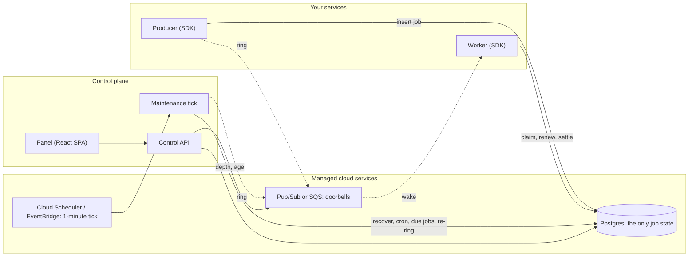

# Architecture

The packages, how a job moves between them, and the rules that keep them apart. [concepts.md](concepts.md) explains the
ideas; [DESIGN.md](../DESIGN.md) holds the decisions and the reasons behind them. Read this page before you change code.

## The shape

Solid lines carry state and are transactions. Dotted lines carry bells, which are at-least-once and repairable. Nothing
that is dotted can lose a job: the tick rings again whatever is claimable.

## Packages

| Package | Holds | Depends on |
| --- | --- | --- |
| `core` | Job types, the state machine, option validation, flows, webhooks' crypto, and the two ports: `StateStore` and `DeliveryTransport`. No I/O. | nothing |
| `store-postgres` | The one `StateStore`: the claim query, leases, retry, the DLQ, cron, events, workflows, the schema and its forward-only migrations. | `core` |
| `transport-local` | Doorbells over Postgres: polling plus `LISTEN`/`NOTIFY`, and an in-memory transport for tests. | `core` |
| `transport-gcp` | Pub/Sub: one topic per environment, a filtered subscription per queue, a dead-letter topic. | `core` |
| `transport-aws` | SQS: a queue and a dead-letter queue for each Qelay queue, `DelaySeconds` up to 15 minutes. | `core` |
| `transports` | The one place that turns a configured name (`postgres`, `gcp-pubsub`, `aws-sqs`) into a transport. | `core`, the three transports |
| `sdk` | `Queue`, `Worker`, `FlowProducer`, `QueueEvents`, and the workflow engine, in the shape of Qelay's classes. Published as `qelay-cloud`. | `core`, `store-postgres` |
| `maintenance` | The tick (`qcloud-tick`), its leader lease and loop, and the webhook sender. | `core`, `store-postgres`, `transports` |
| `control-api` | The HTTP service the panel talks to, `/internal/tick`, `/capabilities`, `migrate`. | `core`, `store-postgres`, `transports` |
| `panel` | The React app and the small server that hands it `/config.json`. | the Control API, over HTTP only |
| `infra/gcp`, `infra/aws` | Terraform: a data plane and a control plane for each cloud. | - |

The SDK takes a transport as an argument and never imports one. That is why an application chooses its broker in one line,
and why a new broker is a new package and a row in `transports`.

## How one job moves

1. **Add.** `Queue.add` validates the options (`core`), then `store.enqueue` inserts the row and returns the bells to ring,
   with the delay measured on the database clock. The queue rings them after the commit and tells the store which ones the
   broker took (`markRung`). A ring that fails is logged and left for the tick.
2. **Wake.** The transport delivers a bell to a worker that subscribed to the queue. The bell names a queue and a job as a
   hint only.
3. **Claim.** The worker asks the store for as many jobs as it has free slots. The claim is one statement
   (`FOR UPDATE SKIP LOCKED`, in queue order) that sets a lease token and a deadline. The worker acknowledges the bell now,
   not when the job ends.
4. **Run.** The processor gets the job and an `AbortSignal`. The worker renews the lease at a third of its length. If a
   renewal finds the lease gone, the signal aborts.
5. **Settle.** `complete` or `fail` is one transaction guarded by the lease token. It records the result, writes the event
   journal, wakes a flow parent whose last child just finished, and returns the bells for a retry. Without the token
   nothing changes.
6. **Repair.** The tick recovers expired leases (counting the attempt), starts due cron entries, rings jobs that have come
   due, and rings every claimable job whose last bell is old, up to a cap.

Every change of a job's state goes through `core`'s transition table, so the store, the model tests and the Control API
agree on what a state can become.

## The Control API and the panel

The Control API is a stateless HTTP service. Reads are reads of Postgres; counts of what the broker holds come from the
transport's `stats`. A write is one store call: with a lease token when a worker makes it, with a version check when an
operator does. A request for something the SDK does not support answers `501 not_supported`. The routes are generated into
[reference/routes.md](reference/routes.md) and the contract in [openapi.yaml](openapi.yaml).

The panel is a port of the Qelay control panel. Its HTTP layer was rewritten against the Control API, the pages that managed
processes or SQLite were removed, and every other page is the original's. It holds no secrets: it signs the user in with
OpenID Connect (or a development token) and sends the bearer token to the API.

## Rules the build enforces

`bun run architecture` and the tests fail when:

- a file is over 300 lines;
- `core`, `sdk`, `store-postgres`, `maintenance` or `control-api` imports a broker package or names a broker kind. A
  difference between brokers is a **capability** the transport declares (`maxDeliverDelayMs`, `maxRingBatch`, ...), and the
  contract tests run against every transport ([transports.md](transports.md));
- the workflow engine reaches past the store port and the SDK's queue, or imports SQLite, a socket or the upstream client;
- a migration is edited after it shipped, or the schema snapshot does not match the migrations.

## Where the details are

| You want | Read |
| --- | --- |
| The decisions and what was rejected | [DESIGN.md](../DESIGN.md) |
| What differs from Qelay, method by method | [compat.md](compat.md) |
| Sizes, throughput, guarantees and what was never run | [limits.md](limits.md) |
| Which broker can do what | [transports.md](transports.md) |
| Where ported code came from | [PORTING.md](PORTING.md) |
| Every setting | [reference/configuration.md](reference/configuration.md) |
| How to build, test and change it | [CONTRIBUTING.md](../CONTRIBUTING.md) |
